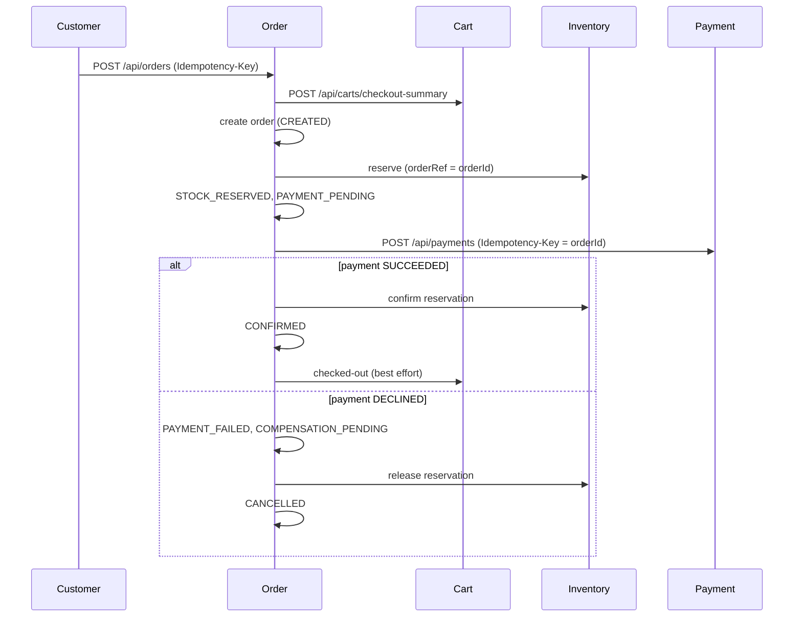

# Architecture

## Services

Six independent Spring Boot applications, each in its own folder with its own `pom.xml` and its own H2 database.

| Service | Port | Responsibility | URL variable |
| --- | --- | --- | --- |
| identity-service | 8081 | Registration, login, JWT, profile, RBAC | `IDENTITY_URL` |
| catalog-service | 8082 | Products, categories, SKU, prices, search | `CATALOG_URL` |
| inventory-service | 8083 | Stock, reservations, adjustments, expiry | `INVENTORY_URL` |
| cart-service | 8084 | Cart, pricing, discount rules, checkout summary | `CART_URL` |
| order-service | 8085 | Checkout orchestration, order states, cancellation, recovery | `ORDER_URL` |
| payment-service | 8086 | Simulated payments, refunds, idempotency | `PAYMENT_URL` |

Principles: independently buildable, explicit REST APIs, own persistence (no cross-service database access, ids from
other services are plain values), standard error body, health endpoints, structured logging, automated tests.

## Layering

`api` (controllers, DTO records, exception handler) -> `service` -> `repository` / `domain`. Outbound calls live in
`client`, security in `security`, configuration in `config`.

## Communication and tokens

- REST through the shared `RestClient.Builder` (connect timeout 1000 ms, read timeout 2000 ms, `CLIENT_READ_TIMEOUT_MS`).
- At most 2 retries with 500 ms backoff, only for idempotent calls (GET, confirm, release, refund, restock). Never for
  the initial payment POST: reconciliation repeats it with the same Idempotency-Key instead.
- `X-Correlation-Id` is read or generated per request, stored in MDC and forwarded on every outbound call.
- Order forwards the customer's bearer token only to Cart. Calls to Inventory and Payment, and all background work,
  use a short-lived SERVICE token minted with the shared `JWT_SECRET` (ADR-004: demo-environment trust model).
- Downstream failures become `503 DEPENDENCY_UNAVAILABLE` with a generic message.

## Checkout saga (Order service)

Each persisted state change is its own short local transaction; no remote call runs inside a transaction.

## Order state table

| From | To | Trigger |
| --- | --- | --- |
| CREATED | STOCK_RESERVED | Inventory returned a PENDING reservation |
| CREATED | STOCK_UNAVAILABLE | Inventory returned 409 INSUFFICIENT_STOCK (terminal; HTTP 409) |
| CREATED | CANCELLED | Inventory unreachable: reason INVENTORY_UNAVAILABLE; HTTP 503 |
| STOCK_RESERVED | PAYMENT_PENDING | Persisted immediately before calling Payment |
| PAYMENT_PENDING | CONFIRMED | Payment SUCCEEDED and reservation confirmed |
| PAYMENT_PENDING | PAYMENT_FAILED | Payment DECLINED (or a timeout reconciled as DECLINED) |
| PAYMENT_PENDING | COMPENSATION_PENDING | Payment SUCCEEDED but confirm rejected (reservation lost): refund requested |
| PAYMENT_FAILED | COMPENSATION_PENDING | Release requested (persisted before the call) |
| COMPENSATION_PENDING | CANCELLED | Release returned RELEASED or EXPIRED, or the refund completed |
| CONFIRMED | CANCELLED | Customer or admin cancels: refund then restock |
| PAYMENT_FAILED | CANCELLED | Cancel request |

## Recovery

`POST /api/orders/{id}/recover` and a scheduled job (`ORDER_RECOVERY_INTERVAL_MS`, default 60000, only orders older than
`ORDER_RECOVERY_MIN_AGE_MS`) resume from the persisted state: reconcile `PAYMENT_PENDING` through the same
Idempotency-Key, retry release or refund for `COMPENSATION_PENDING`, and re-send the cart checked-out call.

## Configuration

All endpoints, timeouts and secrets come from `application.yml` and environment variables: `JWT_SECRET` (min 32 chars),
`JWT_EXPIRY_MINUTES`, `SEED_ADMIN_PASSWORD`, `SERVER_PORT`, `*_URL`, `CLIENT_READ_TIMEOUT_MS`,
`INVENTORY_RESERVATION_TTL_MINUTES`, `PAYMENT_SIMULATED_TIMEOUT_MS`, `ORDER_RECOVERY_INTERVAL_MS`.
